<p align="center">
  
</p>

<p align="center">The final say on every action your AI agents take.</p>

Arbitr sits between an AI agent and the tools it calls. Before a tool runs,
Arbitr writes the call to a ledger and checks it against rules you wrote.
Then it lets the call run once, holds it for a human, or blocks it.

- **Dangerous actions are stopped before they run.** Your policy decides, not a
  model. `DROP TABLE` from an agent is denied even when the tool was declared
  harmless, because Arbitr reads the SQL itself.
- **Retries never do things twice.** An agent that retries a refund after a
  timeout gets the first refund's receipt back, not a second refund. This holds
  even when the process is killed in the middle of the call.
- **Every action has a receipt.** Who asked, what ran, what was decided and why,
  in a tamper-evident audit chain you can verify.

> **Status: early development.** The core works and is heavily tested, but the
> API will change and there is no release yet. Do not put it in front of
> production systems yet. See [what works today](#what-works-today).

## Quickstart

Arbitr needs Python 3.11 or newer. Install it from source:

```
pip install "git+https://github.com/Nagendhra-web/arbitr"
```

Write a policy and wrap your tool calls:

```python
import secrets

from arbitr.core.errors import ActionDenied, ApprovalPending
from arbitr.core.spec import ToolSpec
from arbitr.executor import Ledger
from arbitr.policy.schema import load_policy

policy = load_policy("""
version: 1
rules:
  - id: no-destructive-sql
    when: { tool: db.execute, effect: destructive }
    then: deny
    reason: Agents may not run destructive SQL.
  - id: big-refunds
    when:
      tool: payments.refund
      args: [{ path: "$.amount", op: gt, value: 100 }]
    then: require_approval
    reason: Refunds over 100 need a human.
  - id: refunds
    when: { tool: payments.refund }
    then: allow
    reason: Small refunds are fine.
""")

run_sql = ToolSpec(name="db.execute", effect="write")
refund = ToolSpec(name="payments.refund", effect="financial", idempotency="native")


def refund_order(order_id, amount, idempotency_key):
    # Your real payments call goes here. Pass idempotency_key on to the provider.
    return {"refund_id": "re_1", "order_id": order_id}


key = secrets.token_bytes(32)  # keep a stable key in production: it signs redactions
with Ledger.open("arbitr.db", policy, key=key) as ledger:
    with ledger.run(principal="alice", agent_id="support-bot"):
        ledger.execute(refund, {"order_id": "o-1", "amount": 25}, refund_order)

        # The agent retries the same call: the stored receipt comes back.
        ledger.execute(refund, {"order_id": "o-1", "amount": 25}, refund_order)

        try:
            ledger.execute(run_sql, {"sql": "DROP TABLE customers"}, print)
        except ActionDenied as denied:
            print(denied.to_tool_message())

        try:
            ledger.execute(refund, {"order_id": "o-2", "amount": 500}, refund_order)
        except ApprovalPending as pending:
            print(pending.to_tool_message())

    print("audit chain ok:", ledger.verify().ok)
```

Output:

```
Blocked by policy 'no-destructive-sql': Agents may not run destructive SQL. Do not retry. Ask the user.
This action needs human approval (request 01M5...): Refunds over 100 need a human. It has not run. Do not retry now; tell the user it is waiting for approval.
audit chain ok: True
```

The refund ran once, the retry did not refund again, the `DROP TABLE` never
reached the database, and the large refund is waiting for a person. The
messages are written for the agent, so you can hand them straight back to the
model as the tool result.

## How it works



Every tool call becomes an action intent and goes through five steps:

1. **Canonicalize.** The call becomes canonical JSON with an intent hash and an
   idempotency key, so the same action always looks the same.
2. **Write ahead.** The intent is written to the ledger before anything runs.
   After a crash, Arbitr knows what was attempted.
3. **Decide.** A deterministic gate checks your rules, the resources the call
   touches (tables, paths, URLs, repositories, recipients), budgets and what the
   run has read so far. It answers allow, deny, require approval or delay. No
   language model is involved.
4. **Approve when it matters.** An approval is bound to the exact arguments it
   was given for, so it cannot be reused for a different call.
5. **Execute once.** The call runs under a lease on the database clock. If the
   worker dies, the next attempt recovers according to the tool's idempotency
   mode, and the side effect still happens at most once.

Secrets are redacted before anything is stored, and every state change is
recorded in an audit chain that `verify()` checks.

## What works today

- **The ledger:** SQLite storage, a tamper-evident audit chain, and redaction of
  secrets, tokens, card numbers and private keys before anything is written.
- **The policy engine:** YAML policies with a published JSON Schema.
  - Rules on tools, effects, arguments, resource tags, time windows and the run's scope.
  - Budgets per principal, agent, run, tool, day or hour.
  - Shadow mode, and checks for data leaving through messages (secrets, card
    numbers, private text the run read earlier).
- **Resource extraction:** Arbitr reads SQL, shell commands, paths, URLs, email
  recipients and GitHub API calls. It raises an action's effect when it finds
  `DROP`, `rm -rf`, `git push --force`, `terraform destroy` and similar, even
  inside `sh -c` or a pipe.
- **Ten policy packs** to include by name: databases, filesystem, git,
  cloud-cli, kubernetes, payments, email-and-messaging, github, mcp-basics and
  lethal-trifecta.
- **The executor:** exactly-once execution with leases and heartbeats, and
  recovery by idempotency mode.
  - Cancel windows (`then: delay 60s`) with `cancel()` and a scheduler.
  - Credentials injected only after the gate allows the call, and scrubbed from
    everything the agent sees.
  - Details in [docs/recovery.md](docs/recovery.md).
- **Approvals:** bound to the exact arguments, expiring, with quorum, roles
  and approvers kept apart from the person the agent acts for. Signed one-tap
  links, a webhook channel and blast radius previews on every approval card.
- **Integrations:** a `@guard` decorator, and adapters for the Anthropic SDK,
  the OpenAI Agents SDK and LangGraph. See
  [docs/integrations](docs/integrations/index.md).
- **An MCP proxy:** `arbitr mcp-proxy` sits between an MCP client (Claude
  Code, Cursor and others) and an MCP server, over stdio or streamable HTTP.
  Every call goes through the ledger and the policy, and every tool
  definition is pinned: a server that changes a tool's description after
  install cannot reach the model until you accept the change. See
  [docs/integrations/mcp-proxy.md](docs/integrations/mcp-proxy.md).
- **A testing kit:** a pytest plugin with fixtures, assertions such as
  `assert_no_effect(run, "destructive")`, fakes and crash injection, so your
  own CI can prove what your agent cannot do. See [docs/testing.md](docs/testing.md).
- **A CLI:** `arbitr init`, `config check`, `approvals`, `runs`, `intents`,
  `recover`, `verify`, `export`, `mcp-proxy`, `mcp pin`, and `policy test`,
  `lint`, `packs` and `schema`. Install the CLI with
  `pip install "arbitr[cli] @ git+https://github.com/Nagendhra-web/arbitr"`.

Recovery depends on what the tool can promise:

| Idempotency mode | After a crash |
|---|---|
| `native` | Runs again with the same key; the service deduplicates (like Stripe's Idempotency-Key). |
| `probe` | Asks the service whether the action happened, and runs again only if it did not. |
| `none` | Stops and waits for a human or the policy's `on_unknown` rule. Never retried silently. |

## Coming next

Slack approvals, a shadow report and local dashboard, Postgres and an HTTP API.

## How it is tested

Arbitr is safety software, so its claims are tested:

- **Crashes at every step.** A test kills a real worker process at every step
  of the protocol, for every idempotency mode, and checks the side effect
  happened at most once.
- **Races.** 50 threads and 8 processes call one tool with one key at the same
  moment; the tool runs once.
- **A model of the protocol.** The execution protocol is written as a TLA+ model
  and checked with TLC for at-most-once effects, no silent retries and no
  execution without a ledger record.
- **Deterministic simulation.** 2,000 seeded runs of the real executor with
  crashes, lease takeovers and cancels, each one reproducible from its seed.
- **The checks around it.** Property tests, fuzz tests, mypy in strict mode, and
  CI on Python 3.11, 3.12 and 3.13.

## Development

CI runs on your machine, not on GitHub Actions:

```
make setup      # install dependencies and git hooks
make ci-fast    # lint, types and unit tests (about a minute)
make ci         # the full pipeline, required before every commit and push
```

See [CONTRIBUTING.md](CONTRIBUTING.md). To report a security problem, see
[SECURITY.md](SECURITY.md).

## License

Apache 2.0. See [LICENSE](LICENSE).
